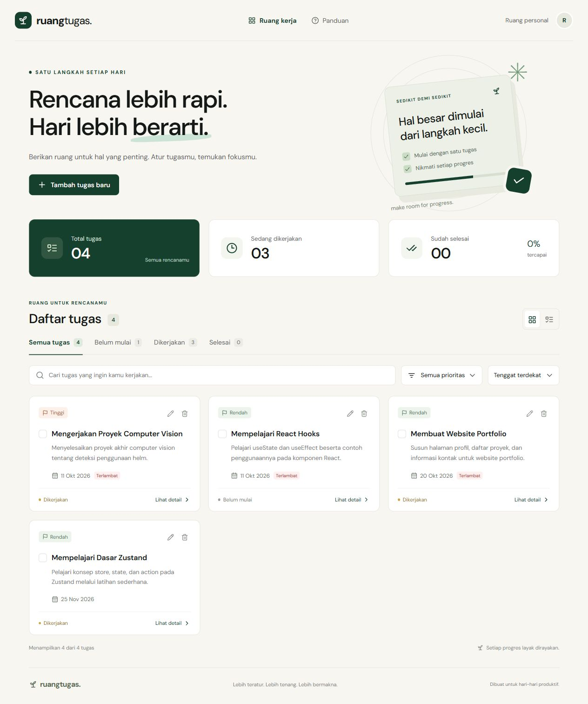

# Ruang Tugas

Aplikasi frontend to-do list menggunakan React.js dan Vite. Desain mengadaptasi panduan `design (3).md`: latar krem, hijau hutan, aksen sage, tipografi DM Sans, kartu membulat, dan tata letak responsif.

## Menjalankan

Memerlukan Node.js 20.19+ atau 22.12+ dan npm.

```sh
npm install
npm run dev
```

Buka alamat Local yang dicetak Vite. Untuk produksi:

```sh
npm run build
npm run preview
```

## Fitur

- Daftar dan detail tugas dengan seluruh atribut: `id`, `title`, `description`, `priority`, `deadline`, `status`.
- Tambah dan ubah tugas melalui formulir dengan validasi.
- Hapus tugas dengan konfirmasi, serta notifikasi hasil operasi.
- Tandai selesai dan buka kembali tugas.
- Pencarian judul/deskripsi, filter status/prioritas, dan pengurutan.
- Tampilan kartu/daftar, ringkasan progres, indikator tenggat dan keterlambatan.
- React State memperbarui tampilan tanpa reload; localStorage menyimpan data antar-kunjungan.
- Dialog native dengan dukungan Escape, navigasi keyboard, dan fokus.

Empat data awal mengikuti judul, prioritas, tenggat, dan status pada screenshot Kuis.pdf. Deskripsi Computer Vision mengikuti halaman detail; deskripsi tiga tugas lainnya merupakan pelengkap dummy. Label `high/low` dan `in progress/to-do` ditampilkan dalam bahasa Indonesia sebagai `Tinggi/Rendah` dan `Dikerjakan/Belum mulai`.

Tidak ada backend atau pemanggilan REST API. Untuk integrasi berikutnya, gunakan struktur tugas yang sama dan pindahkan operasi state ke lapisan layanan API. Data lokal terpisah untuk setiap browser/origin. Jika penyimpanan browser diblokir, aplikasi memberi peringatan dan tetap dapat digunakan pada sesi aktif.

## Struktur

```text
src/main.jsx       Komponen React, data dummy, state, dan operasi tugas
src/style.css      Token visual, komponen, dan layout responsif
index.html         Entry point
.openai/hosting.json  Konfigurasi hosting statis
```

## Verifikasi

Build produksi berhasil melalui Vite. Alur tambah, detail, ubah, persistensi setelah reload, dan hapus telah diuji di browser. Tampilan ponsel diperiksa tanpa overflow horizontal. Dokumentasi ini tidak menyatakan bahwa repositori GitHub telah dibuat atau tugas telah dikumpulkan.

## Screenshot


